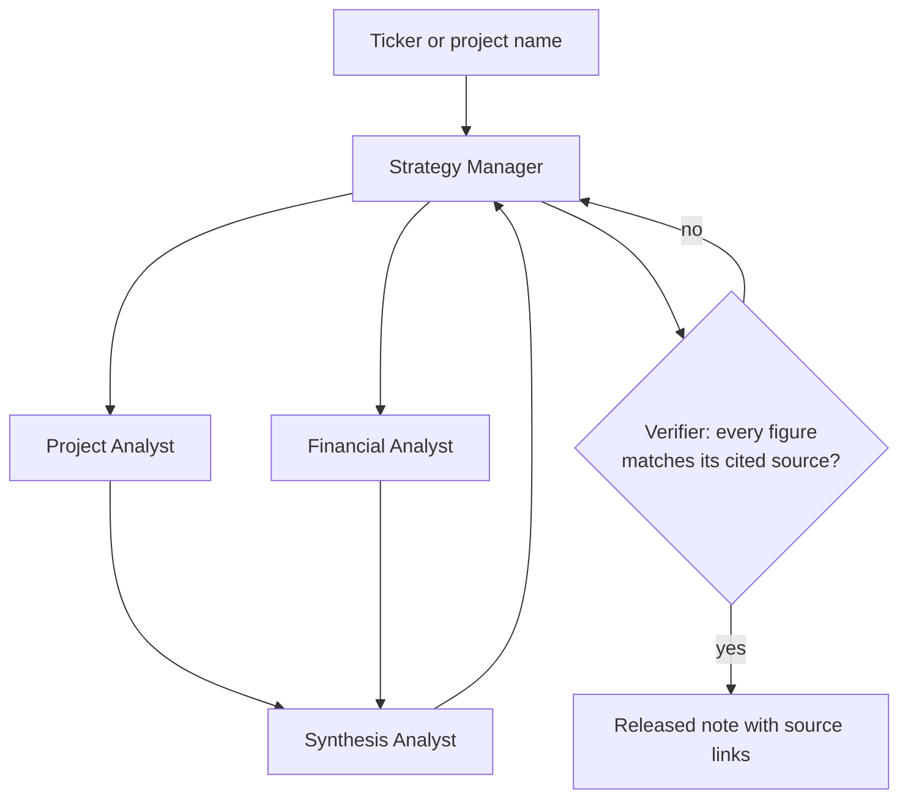

# Coverage for the Uncovered

**AI-generated equity research for under-covered mining and commodity equities**

Jess Tran · Purdue University, Mitch Daniels School of Business · Independent project · Proposal, October 2026

> **Status:** proposal. No code yet. This README describes the system, the validation design, and what I am asking for.

---

## Executive summary

I propose building a multi-agent AI system that produces analyst-style research notes for junior and mid-tier mining companies that have little or no sell-side coverage, and validating it with the blinded, paired evaluation protocol from Francis and Zhang (2026).

The paper shows that a four-agent GPT-4o team can write reports that non-expert readers rate above Value Line. It also shows the system generates no alpha, and its powered evidence comes from general-population evaluators, not professionals. So the product sells coverage and synthesis, not stock picks, and the first milestone is the expert evaluation the paper itself calls for.

Junior miners are the right first market because the coverage gap is extreme, the source documents are standardized (NI 43-101 and S-K 1300 technical reports, quarterly operational updates), and project economics can be recomputed from disclosed inputs. At Glencore I wrote research reports on junior mining projects (White Gold Corp, Black Butte Copper, Surge Copper) for the trading desk by hand. This project turns that workflow into a system and tests whether it holds up under expert review.

## The problem: a coverage gap that is widest in commodities

Junior miners typically have zero or one sell-side analyst, and the one is often the broker that underwrote the last raise. I will report actual coverage counts for the Stage 1 sample rather than assert a number here.

The paper makes the general point. Its 50 firms have a median market cap of $248M, and the 25th-percentile firm has zero analyst coverage, although median coverage is 21 analysts (Table 1, Panel A). In the general-population sample, the AI's advantage over Value Line was larger for below-median-coverage firms (gap 1.83 vs 1.10, both p < 0.01; Table 3). The graduate-student sample points the same way but is not significant (gap 1.14 vs 0.13, p = 0.10), and the LLM judges show the larger gap for above-median firms (0.41 vs 0.14), so this is suggestive, not settled. MiFID II research unbundling and fee compression have pushed sell-side budgets toward large caps, leaving the long tail of resource companies with abundant public disclosure and almost no synthesis.

The consequences are concrete. Hong, Lim and Stein (2000) show low-coverage firms incorporate information more slowly. In practice, a trader or concentrate buyer evaluating a junior copper project has to read a 300-page technical report, a handful of news releases, and a financing history to answer basic questions: what stage is the project, who funds it, what are the offtake terms, what is the capex and NPV at today's copper price. At Glencore I did this project by project, and the output was a short summary the desk could act on. That summary is the product.

Three features make this segment a better first target than generic small caps:

- **The source documents are standardized.** Technical reports follow NI 43-101 (Canada) or S-K 1300 (US; filed on EDGAR as Exhibit 96), so the same fields appear in the same item numbers across companies.
- **Economics are recomputable from disclosed inputs.** PEA, PFS and FS reports state capex, operating cost, production schedule and NPV/IRR, and most include a price-sensitivity table. Re-pricing to spot is the main judgment call.
- **The readers have real stakes but no research budget:** trading desks, concentrate buyers, resource private equity, and retail investors in junior miners.

## Evidence base: what Francis and Zhang (2026) show

The paper supports the narrow claim that a multi-agent system can produce research that non-expert readers find comparable to professional work. It does not support the claim that such research generates returns.

| Finding | Result | What it means for this project |
|---|---|---|
| General-population evaluators (49 participants, 194 paired evaluations) | AI 8.13 vs Value Line 6.64 (p < 0.01); AI preferred 77% | Non-specialist readers accept AI-written reports; this is the powered result |
| Finance graduate students (15 MSF students, 45 paired evaluations) | 7.09 vs 6.47, not significant; 51% preference | Expert-adjacent readers are undecided; underpowered, so an open question, not a negative |
| LLM judges (4 models × 50 pairs = 200 judgments) | AI 7.08 vs 6.81 (p < 0.01); AI preferred 71% overall, but 48% to 96% by model | LLM-as-judge is unstable; human evaluation is required for any claim |
| Below-median coverage firms | General-population gap 1.83 vs 1.10 for above-median (both p < 0.01); LLM judges show no stable pattern | Among non-experts, the edge is largest where coverage is thin, which is the target segment |
| Portfolio tests (1 and 2 months) | Neither AI nor Value Line differs significantly from 1/N; all six-factor alphas insignificant | Do not sell returns; sell synthesis, speed and coverage |

The design features worth copying are the paired, blinded protocol, evaluator-clustered standard errors, and a professional benchmark as the comparator. The gap the authors name is expert evaluation; this project fills it with mining analysts and traders as judges.

Two caveats shape the design. First, the paper showed both reports as plain text but preserved each source's section headers and paragraph organization. The authors treat any organizational advantage of the AI reports as a genuine dimension of quality for non-expert readers, not a confound (Section 3.3). For professional readers that is less clear: some of the preference may be formatting rather than content. This project normalizes formatting before evaluation (see Stage 2). Second, the paper did not measure factual accuracy separately from perceived quality. A product for professionals has to do both.

## Product concept

Working name: **Orebody**. A user enters a ticker or project name and receives a five-section note built from the company's own filings and technical reports, with every number linked to its source page. The note refreshes when a new filing, technical report, or material news release lands.

Each note follows a fixed template, which is what the paper's Strategy Manager enforces and what evaluators rewarded:

1. **Project snapshot.** Commodity, jurisdiction, stage (exploration, PEA, PFS, FS, construction, production), resource and reserve tonnage and grade, mine life.
2. **Capital structure and funding.** Cash, debt, burn rate, estimated runway, recent raises, major shareholders, streaming or royalty encumbrances.
3. **Economics.** Stage-dependent:
   - *Studied projects (PEA, PFS, FS, production):* initial capex, AISC or C1 cost, NPV and IRR at the company's base-case price, the rebuilt NPV at spot and at two user-selected price decks, and the **breakeven price** at which NPV = 0.
   - *Explorers with no economic study:* no NPV. Enterprise value per unit of contained metal in resource, against a peer set.
4. **Offtake and commercial terms.** Existing offtake agreements, TC/RC exposure for concentrate producers, counterparties, and what remains uncommitted.
5. **Catalysts and risks.** Permitting milestones, financing needs, drill results due, and a one-paragraph synthesis of what the disclosed numbers imply. No Buy/Hold/Sell rating.

What makes this different from a generic AI summary is section 3: the agent does not quote the company's NPV, it rebuilds it and re-prices it. Where the technical report includes an annual cash-flow table, the agent re-runs it at the new price. Where it does not, the agent interpolates from the report's own price-sensitivity table and says so. A junior miner's headline NPV is almost always at a price above spot, and the gap, plus the breakeven price, is the first thing a professional reader wants to see.

I dropped the Buy/Hold/Sell stance from the original concept. The paper's portfolio results give no basis for a rating, a rating sold to the public raises investment-adviser questions, and a breakeven price is more useful to a trader anyway: it tells the reader what they have to believe about the commodity, not what to do.

Who it is for, in order of priority:

1. Physical trading and concentrate desks screening supply pipelines (my Glencore use case).
2. Resource-focused private equity, family offices and royalty companies doing first-pass diligence.
3. Retail investors in junior miners, the population the paper's powered evidence actually covers.

What it is not: an investment recommendation service or a return-generating signal.

## System design

The architecture keeps the paper's four-agent hierarchy and adds two things it lacked: a domain-specific data layer for mining disclosures and a Verifier agent that checks every number against its source before release.

| Agent | Role | Tools | Output |
|---|---|---|---|
| Strategy Manager | Orchestrates the workflow, enforces the template, triggers revisions on inconsistency | Internal state only | Final compiled note |
| Project Analyst | Stage, geology, resource and reserve statements, permitting, jurisdiction | SEDAR+ and EDGAR filing parser, technical-report section extractor, news search | Snapshot, catalysts, risks |
| Financial Analyst | Capital structure, runway, offtake terms, rebuilt NPV and breakeven price | Filing parser, LME and COMEX price feed, DCF calculator | Funding, economics, offtake sections |
| Synthesis Analyst | Turns upstream sections into the section 5 synthesis | Upstream outputs only | Section 5 |
| Verifier | Checks every figure in the draft against the cited source page; sends unsupported claims back to the Manager | Filing parser, citation index | Pass/fail per figure |

The Verifier is the main departure from the paper. A professional reader will discard a note with one wrong capex figure, and the source link on every number makes the accuracy audit in the validation plan possible.

**Data inputs, all public:** SEDAR+ and EDGAR filings, NI 43-101 and S-K 1300 technical reports, company news releases, LME and COMEX settlement prices, and a curated list of mining trade publications. The price feed reuses the copper data I built for my copper market balance model.

**No look-ahead.** For any note matched to a comparator, the agents only see filings and prices dated on or before the comparator's publication date, the same discipline as the walk-forward tests in my hedge and TSMOM projects. The model's training data may still contain later information; I will use the most recent quarter possible and note this as a limitation, as the paper does with its 2024Q3 baseline.

**Model choice** follows the paper: a single frontier model for all agents, swapped as better models arrive. The design is model-agnostic.

## Target users and go-to-market

The first users are trading desks and resource investors who already do this work by hand, because they can judge the output and will pay for time saved. Retail follows once the expert evaluation is in hand.

| Segment | Their current process | What they would use |
|---|---|---|
| Physical trading and concentrate desks | Junior analysts and interns read technical reports project by project | A screened pipeline of supply projects, refreshed on every filing |
| Resource PE, family offices, royalty companies | Outsourced or in-house first-pass diligence | Standardized notes across a watchlist of 50 to 200 names |
| Junior mining IR teams | Pay for issuer-sponsored research of uneven credibility | A sourced, template-driven note, labelled as issuer-paid |
| Retail investors in junior miners | Forums and promoter newsletters | Readable notes with every number linked |

The issuer-paid segment needs care: a company-funded note that reads well is exactly the kind that invites scrutiny. Any such note carries the funding disclosure in its header and goes through the same template and Verifier as unpaid notes. Pricing is left open until the pilot shows how much time the notes actually save.

## Validation plan

The project replicates the paper's protocol with the evaluators it lacked: professionals who assess mining companies for a living. Each stage has a pass condition set before the data come in.

### Stage 1: build and accuracy audit

Generate notes for 25 to 30 copper and zinc companies, chosen because each has a third-party professional note (broker or issuer-sponsored) for the same company and quarter. Uncovered names are the long-run market, but they cannot be tested blind against a professional benchmark, so they go to Stage 3.

Accuracy is measured directly, not through the Verifier's own flag rate:

- **Audited error rate.** Draw a random sample of 200 figures across released notes and check each against the source page by hand. Pass: under 2% wrong, and zero wrong capex, NPV or resource figures.
- **Verifier recall.** Seed known errors into 10 drafts and count how many the Verifier catches. Pass: 90% or more.

### Stage 2: blinded expert evaluation

Recruit 15 to 20 evaluators with mining-sector experience: sell-side metals analysts, trading-desk staff and resource-fund analysts, reached through Purdue alumni, my Glencore network and conference contacts. Each scores 5 to 6 blinded, randomized pairs, for roughly 90 to 120 paired evaluations.

Blinding is tighter than the paper's. Both notes in a pair are converted to plain text under the same five section headers, and source links are stripped from the system note. This removes the formatting advantage the paper flags, so any preference that survives is about content.

Evaluators score the paper's five dimensions (clarity, depth, data relevance, logical consistency, actionable insight) and give a head-to-head preference. Inference follows the paper: paired differences with evaluator-clustered standard errors, robust to two-way clustering by evaluator and pair. Factual accuracy is not asked of evaluators, since they cannot check a 300-page report in a session; it comes from the Stage 1 audit.

**Power.** About 100 paired evaluations can detect a preference gap of roughly 15 to 17 points from 50/50 at 80% power, not 10; detecting 10 points would take about 200 pairs, the size of the paper's general-population sample. So Stage 2 is framed as a non-inferiority test, not a superiority test.

**Pass condition:** the 95% confidence interval on the expert preference rate excludes 35%, meaning experts are not clearly rejecting the notes. With about 100 pairs this requires a point estimate of roughly 46% or higher. The paper's graduate students sat at 51%.

### Stage 3: usage pilot

Pilot with one trading desk and one resource investor, now including uncovered names. Measure time from request to decision, how often a note is cited in internal discussion, and what users correct. Pass: users report time savings and keep using the notes after the pilot without being asked.

### Timeline

Stages 1 and 2 fit one semester (spring 2027). Stage 3 runs after, if Stage 2 passes.

| Weeks | Work |
|---|---|
| 1 to 4 | Technical-report parser and agent pipeline for 10 copper names; IRB submission |
| 5 to 9 | Full Stage 1 sample, accuracy audit, Verifier recall test |
| 8 to 13 | Evaluator recruitment and Stage 2 sessions |
| 14 to 16 | Analysis and write-up |

What this plan repeats from the paper on purpose: a professional benchmark, and human rather than LLM judges, since the paper's LLM preferences ranged from 48% to 96% by model. What it adds: format-normalized blinding, a direct accuracy audit, and a stage-dependent valuation template.

## Risks and limitations

The largest risk is that professionals reject the notes even when non-experts accept them, which is exactly the gap the paper leaves open. Stage 2 is designed to surface that before any further build.

| Risk | Why it matters | Mitigation |
|---|---|---|
| Experts rate the notes below the benchmark | The paper's grad students split 51/49; professionals may be harsher | Stage 2 is a go/no-go gate; if it fails, the tool narrows to internal drafting |
| Factual errors in capex, NPV or resource figures | One wrong number ends credibility with a trading desk | Verifier, source links on every figure, Stage 1 audit and seeded-error test |
| Technical reports are long and inconsistent | 300-page PDFs with tables that parse badly; the paper's context-length point applies | Section-level extraction keyed to NI 43-101 and S-K 1300 item numbers; manual check of parser output |
| Comparator sample is small | Few junior miners have a professional note for a given quarter | Select the Stage 1 sample on comparator availability; widen to gold or nickel if copper and zinc fall short |
| Model self-preference and evaluator bias | Panickssery et al. (2024) show LLM judges favor their own text | Human evaluation only; LLM judges for internal regression tests at most |
| Data access | SEDAR+ has no bulk API; LME prices carry redistribution terms | Manual document pulls for the pilot sample; EDGAR API for S-K 1300 filers; settlement or delayed prices under an appropriate licence |
| Regulatory exposure | Notes sold to the public can look like investment advice | No ratings, no performance claims; counsel before any retail launch |

A limitation to state plainly: the paper's evidence is from 50 US firms across GICS sectors covered by Value Line, with 2024Q3 data and GPT-4o. Nothing in it tests mining companies, technical reports, or re-priced valuations. Those are extrapolations this plan has to earn.

## Why this fits my background

I have done the manual version of this product and built the quantitative pieces it depends on.

- **Glencore (summer 2026).** Wrote research reports on junior mining projects (White Gold Corp, Black Butte Copper, Surge Copper) covering development stage, capital structure, offtake and capex/NPV for the trading desk. That is the template above, by hand.
- **Copper market balance model (October 2026).** A Python supply, demand and price model with a market-clearing price solver and Monte Carlo scenarios. The price feed and NPV re-pricing reuse that work.
- **Copper hedge and TSMOM projects.** Built with out-of-sample, no-look-ahead testing, the discipline the comparator matching needs.
- **EY and Evvolve.** 15+ benchmarking and valuation models at EY; runway and capital-needs models for early-stage companies at Evvolve. Same analysis as section 2 of the note.
- **Supply Chain and Operations coursework.** Concentrate logistics, TC/RC terms and offtake structures, which generic equity research tools do not model.

What I would need help with: the statistics for the Stage 2 design, access to evaluators, and a view on whether this runs as independent study or thesis work.

## Next steps

I am asking for feedback on the concept and the validation design, and for a conversation about whether this could become a supervised project in spring 2027.

1. Feedback on the proposal and the Stage 2 design
2. Decide the format: independent study, thesis, or side project
3. Build the parser and pipeline for 10 copper names as a proof of concept (4 weeks)
4. Submit to Purdue's IRB (Stage 2 is human-subjects research; likely exempt) and draft the evaluator recruitment plan
5. Identify one trading desk and one resource investor willing to pilot

## References

- Francis, A. and Zhang, C. X. (2026). Can AI match professional analysts? Evidence from a multi-agent system. *Finance Research Letters*. [SSRN working paper](https://papers.ssrn.com/sol3/papers.cfm?abstract_id=5584131)
- Hong, H., Lim, T. and Stein, J. C. (2000). Bad news travels slowly: Size, analyst coverage, and the profitability of momentum strategies. *Journal of Finance*, 55, 265–295.
- Panickssery, A., Bowman, S. R. and Feng, S. (2024). LLM evaluators recognize and favor their own generations. *Advances in Neural Information Processing Systems*, 37, 68772–68802.
- Rennekamp, K. (2012). Processing fluency and investors' reactions to disclosure readability. *Journal of Accounting Research*, 50, 1319–1354.
- Cao, S., Jiang, W., Wang, J. and Yang, B. (2024). From man vs. machine to man + machine: The art and AI of stock analyses. *Journal of Financial Economics*, 160, 103910.
